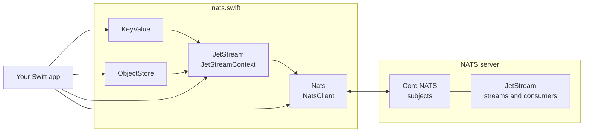
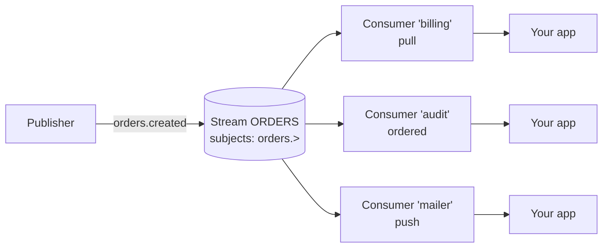

<p align="center">
  
</p>

<h1 align="center">NATS Swift Client</h1>

<p align="center">
  A modern, <code>async</code>/<code>await</code> Swift client for <a href="https://nats.io">NATS</a>,
  with JetStream, a Key-Value Store and an Object Store.
</p>

<p align="center">
  <a href="https://www.apache.org/licenses/LICENSE-2.0"></a>
  <a href="https://swiftpackageindex.com/nats-io/nats.swift"></a>
  <a href="https://swiftpackageindex.com/nats-io/nats.swift"></a>
</p>

<p align="center">
  <a href="#quick-start">Quick Start</a> ·
  <a href="#core-nats">Core NATS</a> ·
  <a href="#jetstream">JetStream</a> ·
  <a href="#key-value-store">Key-Value Store</a> ·
  <a href="#object-store">Object Store</a>
</p>

## Table of Contents

- [Overview](#overview)
  - [What is NATS?](#what-is-nats)
  - [What this package provides](#what-this-package-provides)
  - [Architecture](#architecture)
- [Features](#features)
- [Requirements](#requirements)
- [Installation](#installation)
  - [Swift Package Manager](#swift-package-manager)
  - [Xcode](#xcode)
- [Quick Start](#quick-start)
- [Core NATS](#core-nats)
  - [Connecting](#connecting)
  - [Authentication](#authentication)
  - [TLS](#tls)
  - [Publishing](#publishing)
  - [Subscribing](#subscribing)
  - [Request–Reply](#requestreply)
  - [Events](#events)
  - [Logging](#logging)
  - [App Lifecycle (iOS)](#app-lifecycle-ios)
- [JetStream](#jetstream)
  - [Concepts](#concepts)
  - [JetStream Context](#jetstream-context)
  - [Streams](#streams)
  - [Publishing to Streams](#publishing-to-streams)
  - [Atomic Batches](#atomic-batches)
  - [Consumers](#consumers)
  - [Fetching Messages](#fetching-messages)
  - [Continuous Consumption](#continuous-consumption)
  - [Acknowledging Messages](#acknowledging-messages)
  - [Ordered Consumers](#ordered-consumers)
  - [Push Consumers](#push-consumers)
  - [Priority Groups](#priority-groups)
  - [Managing Consumers](#managing-consumers)
- [Key-Value Store](#key-value-store)
  - [Buckets](#buckets)
  - [Reading and Writing Keys](#reading-and-writing-keys)
  - [Watching Keys](#watching-keys)
  - [Keys and History](#keys-and-history)
  - [Mirrors, Sources and Domains](#mirrors-sources-and-domains)
- [Object Store](#object-store)
  - [Object Buckets](#object-buckets)
  - [Storing and Retrieving Objects](#storing-and-retrieving-objects)
  - [Watching, Links and Sealing](#watching-links-and-sealing)
- [Error Handling](#error-handling)
- [Server Versions](#server-versions)
- [Documentation](#documentation)
- [Examples](#examples)
- [Benchmarks](#benchmarks)
- [Development](#development)
- [Support](#support)
- [License and Attribution](#license-and-attribution)

## Overview

### What is NATS?

[NATS](https://nats.io) is a lightweight, high-performance messaging system for connecting
applications, services and devices. Clients publish messages to **subjects** (such as
`orders.created`) and subscribe to subjects, optionally with wildcards, without needing to know
about each other.

**JetStream** is the persistence layer built into the NATS server. It stores messages in
**streams**, replays them to **consumers** with at-least-once delivery, and powers a
**Key-Value Store** and an **Object Store** on top of streams.

### What this package provides

| Module | Description |
|---|---|
| `Nats` | Core NATS: connections, authentication, TLS, publish/subscribe, request–reply, headers and connection events. |
| `JetStream` | Streams, publishing (including atomic batches), and pull, push and ordered consumers. |
| `JetStreamKeyValue` | The Key-Value Store, built on JetStream. |
| `JetStreamObjectStore` | The Object Store, built on JetStream. |
| `NatsServer` | Runs `nats-server` in integration tests. |

Everything is built on Swift concurrency: calls are `async`, and subscriptions, consumers and
watchers are `AsyncSequence`s you iterate with `for try await`.

### Architecture



## Features

| Area | Capabilities |
|---|---|
| **Connections** | Multiple servers, automatic reconnects, lame duck mode, WebSocket, suspend and resume |
| **Security** | Username/password, token, NKEY, credentials (JWT) files, TLS, mutual TLS, TLS-first handshake |
| **Messaging** | Publish/subscribe, wildcards, queue groups, headers, request–reply, auto-unsubscribe |
| **Streams** | Create, update, delete, list, info, purge, get and delete messages, direct get, mirrors and sources |
| **Publishing** | Acknowledged and asynchronous publishes with backpressure, deduplication, optimistic concurrency, per-message TTLs, message schedules, automatic retries |
| **Consumers** | Pull (`fetch`, `next`, `consume`), push and ordered consumers, flow control, heartbeats, priority groups, pause, resume and reset |
| **Key-Value Store** | Put, get, create, update (compare-and-set), delete, purge, watch, keys, history, per-key TTLs, mirrors, sources and cross-domain buckets |
| **Object Store** | Chunked storage of objects of any size, SHA-256 verification, metadata, links, watch and sealing |

## Requirements

- Swift 6 or later (the package compiles in the Swift 6 language mode, and its public types are
  `Sendable`)
- macOS 13, iOS 13, tvOS 13, watchOS 6 or visionOS 1, or later. On watchOS, apps can only open
  their own network connections in the cases Apple allows (see
  [TN3135](https://developer.apple.com/documentation/technotes/tn3135-low-level-networking-on-watchos))
- A [NATS server](https://docs.nats.io/running-a-nats-service/introduction/installation).
  JetStream features need JetStream enabled on the server (`nats-server -js`).

## Installation

### Swift Package Manager

Add the package to the dependencies in your `Package.swift`, and add the products you use to your
target:

```swift
// swift-tools-version:6.0

import PackageDescription

let package = Package(
    name: "YourApp",
    platforms: [.macOS(.v13), .iOS(.v13)],
    dependencies: [
        .package(url: "https://github.com/nats-io/nats.swift.git", from: "0.5.0")
    ],
    targets: [
        .executableTarget(
            name: "YourApp",
            dependencies: [
                .product(name: "Nats", package: "nats.swift"),
                .product(name: "JetStream", package: "nats.swift"),
                .product(name: "JetStreamKeyValue", package: "nats.swift"),
                .product(name: "JetStreamObjectStore", package: "nats.swift"),
            ]),
    ]
)
```

### Xcode

1. Select your **project** (not a target) in the project navigator.
2. Open the **Package Dependencies** tab and click **+**.
3. Enter `https://github.com/nats-io/nats.swift.git` and add the `Nats` and, if needed,
   `JetStream` products to your target.

## Quick Start

Start a server with `nats-server -js`, then:

```swift
import Foundation
import JetStream
import JetStreamKeyValue
import Nats

// connect
let nats = NatsClientOptions().url(URL(string: "nats://localhost:4222")!).build()
try await nats.connect()

// publish and subscribe
let subscription = try await nats.subscribe(subject: "greetings.>")
try await nats.publish(Data("hello".utf8), subject: "greetings.world")
for try await message in subscription {
    print("\(message.subject): \(String(decoding: message.payload ?? Data(), as: UTF8.self))")
    break
}

// persist messages with JetStream
let js = JetStreamContext(client: nats)
let stream = try await js.createOrUpdateStream(
    cfg: StreamConfig(name: "EVENTS", subjects: ["events.>"]))
try await js.publish("events.signup", message: Data("alice".utf8)).wait()

// store configuration in a key-value bucket
let kv = try await js.createOrUpdateKeyValue(cfg: KeyValueConfig(bucket: "config"))
try await kv.put("theme", "dark")

try await nats.close()
```

## Core NATS

### Connecting

Create a client with `NatsClientOptions` and call `connect()`. The client reconnects automatically
when the connection is lost.

```swift
let nats = NatsClientOptions()
    .urls([
        URL(string: "nats://server-1:4222")!,
        URL(string: "nats://server-2:4222")!,
    ])
    .maxReconnects(10)
    .reconnectWait(2)
    .pingInterval(60)
    .retryOnfailedConnect()
    .build()

try await nats.connect()
print("connected to \(nats.connectedUrl?.absoluteString ?? "")")

// round trip time to the server
let rtt = try await nats.rtt()

try await nats.close()
```

| Option | Description |
|---|---|
| `url(_:)` / `urls(_:)` | Server URLs. Use `nats://`, `tls://`, or `ws://` / `wss://` for WebSocket. |
| `maxReconnects(_:)` | Maximum number of reconnect attempts. |
| `reconnectWait(_:)` | Time to wait between reconnect attempts. |
| `pingInterval(_:)` | Interval of pings used to detect broken connections. |
| `retryOnfailedConnect()` | Keep retrying if the initial connection fails. |
| `retainServersOrder()` | Connect to servers in the given order instead of randomizing it. |
| `inboxPrefix(_:)` | Custom prefix of reply inboxes. |

### Authentication

```swift
// username and password
let withPassword = NatsClientOptions()
    .url(URL(string: "nats://localhost:4222")!)
    .usernameAndPassword("user", "secret")
    .build()

// token
let withToken = NatsClientOptions()
    .url(URL(string: "nats://localhost:4222")!)
    .token("s3cr3t")
    .build()

// NKEY seed, from a string or a file
let withNkey = NatsClientOptions()
    .url(URL(string: "nats://localhost:4222")!)
    .nkeyFile(URL(fileURLWithPath: "/path/to/user.nk"))
    .build()

// decentralized auth with a credentials (JWT) file
let withCredentials = NatsClientOptions()
    .url(URL(string: "nats://localhost:4222")!)
    .credentialsFile(URL(fileURLWithPath: "/path/to/user.creds"))
    .build()
```

### TLS

```swift
let nats = NatsClientOptions()
    .url(URL(string: "tls://localhost:4222")!)
    .requireTls()
    .rootCertificates(URL(fileURLWithPath: "/path/to/ca.pem"))
    // mutual TLS
    .clientCertificate(
        URL(fileURLWithPath: "/path/to/client-cert.pem"),
        URL(fileURLWithPath: "/path/to/client-key.pem"))
    .build()
```

Use `withTlsFirst()` for servers that expect the TLS handshake before the NATS protocol.

### Publishing

```swift
try await nats.publish(Data("order created".utf8), subject: "orders.created")

// with headers
var headers = NatsHeaderMap()
headers.append(try NatsHeaderName("X-Order-Id"), NatsHeaderValue("1234"))
try await nats.publish(Data("order created".utf8), subject: "orders.created", headers: headers)

// make sure everything was sent to the server
try await nats.flush()
```

### Subscribing

Subscriptions are `AsyncSequence`s of `NatsMessage`. Subjects support two wildcards: `*` matches a
single token and `>` matches one or more tokens.

```swift
let subscription = try await nats.subscribe(subject: "orders.>")

for try await message in subscription {
    let body = String(decoding: message.payload ?? Data(), as: UTF8.self)
    print("\(message.subject): \(body)")

    if let orderId = message.headers?[try NatsHeaderName("X-Order-Id")] {
        print("order: \(orderId.description)")
    }
}
```

Subscribers in the same **queue group** share the messages of a subject, each message is delivered
to only one of them:

```swift
let worker = try await nats.subscribe(subject: "tasks", queue: "workers")
```

Stop a subscription with `unsubscribe()`, or after a number of messages with
`unsubscribe(after:)`.

### Request–Reply

```swift
// responder
let service = try await nats.subscribe(subject: "time")
Task {
    for try await request in service {
        if let reply = request.replySubject {
            try await nats.publish(Data(Date().description.utf8), subject: reply)
        }
    }
}

// requester
let response = try await nats.request(Data(), subject: "time", timeout: 2)
print(String(decoding: response.payload ?? Data(), as: UTF8.self))
```

A request throws `NatsError.RequestError.noResponders` when no one is subscribed to the subject,
and `NatsError.RequestError.timeout` when no reply arrives in time.

### Events

Register handlers for connection events with `on(_:_:)`, and remove them with `off(_:)`:

```swift
let listener = nats.on([.connected, .disconnected, .lameDuckMode]) { event in
    print("event: \(event.kind())")
}
nats.off(listener)
```

| Event | Emitted when |
|---|---|
| `.connected` | The client connected or reconnected. |
| `.disconnected` | The connection was lost; the client tries to reconnect. |
| `.suspended` | The connection was suspended with `suspend()`. |
| `.closed` | The connection was closed and will not reconnect. |
| `.lameDuckMode` | The server is shutting down and the client should move to another server. |
| `.error` | An error occurred, e.g. an authorization error. |

### Logging

The client logs through [swift-log](https://github.com/apple/swift-log). The default level is
`.info`:

```swift
import Logging
import Nats

logger.logLevel = .debug
```

### App Lifecycle (iOS)

Suspend the connection when your app moves to the background and resume it when it becomes
active again. Subscriptions are restored on resume.

```swift
func sceneDidBecomeActive(_ scene: UIScene) {
    Task { try await natsClient.resume() }
}

func sceneWillResignActive(_ scene: UIScene) {
    Task { try await natsClient.suspend() }
}
```

## JetStream

### Concepts



- A **stream** stores the messages published on its subjects, according to limits (age, size,
  count) and a retention policy.
- A **consumer** is a view of a stream which tracks which messages were delivered and
  acknowledged. Durable consumers keep their state on the server; ephemeral ones are removed when
  inactive.
- **Pull consumers** deliver messages when the client asks for them. **Push consumers** deliver
  messages to a subject. **Ordered consumers** deliver messages strictly in order without
  acknowledgements.

### JetStream Context

All JetStream operations start from a `JetStreamContext`:

```swift
import JetStream

let js = JetStreamContext(client: nats)

// a JetStream domain (e.g. a leaf node or hub)
let hub = JetStreamContext(client: nats, domain: "hub")

// a custom API prefix and request timeout
let imported = JetStreamContext(client: nats, prefix: "$JS.other.API", timeout: 10)

// usage of the account
let account = try await js.accountInfo()
print("streams: \(account.streams), storage: \(account.storage) bytes")
```

### Streams

```swift
let stream = try await js.createStream(
    cfg: StreamConfig(
        name: "ORDERS",
        subjects: ["orders.>"],
        maxAge: NanoTimeInterval(7 * 24 * 3600),  // keep messages for a week
        storage: .file,
        replicas: 1))

// update, or create if it does not exist
_ = try await js.createOrUpdateStream(
    cfg: StreamConfig(name: "ORDERS", subjects: ["orders.>"], maxMsgsPerSubject: 100))

// look up
if let stream = try await js.getStream(name: "ORDERS") {
    let info = try await stream.info()
    print("\(info.state.messages) messages, \(info.state.bytes) bytes")

    // number of messages per subject
    let perSubject = try await stream.info(subjectFilter: "orders.>")
    print(perSubject.state.subjects ?? [:])
}
let name = try await js.streamNameBySubject("orders.created")

// list
for try await info in await js.streams() {
    print(info.config.name)
}

// read and remove messages
let message = try await stream.getMessage(sequence: 1)
let latest = try await stream.getMessage(lastForSubject: "orders.created")
try await stream.deleteMessage(sequence: 1)
_ = try await stream.purge(subject: "orders.cancelled")

try await js.deleteStream(name: "ORDERS")
```

`StreamConfig` covers retention policies (`.limits`, `.interest`, `.workqueue`), limits, discard
policies, storage, replication, placement, compression, mirrors and sources, subject transforms,
republishing, deduplication windows, direct get, per-message TTLs, subject delete markers, counters
and message schedules.

### Publishing to Streams

`publish` returns an `AckFuture`. `wait()` returns the `Ack` once the server stored the message:

```swift
let ack = try await js.publish("orders.created", message: Data("order 1".utf8)).wait()
print("stored in \(ack.stream) at sequence \(ack.seq)")
```

`PublishOptions` control deduplication, concurrency and delivery:

```swift
let ack = try await js.publish(
    "orders.created", message: Data("order 1".utf8),
    options: PublishOptions(
        messageId: "order-1",             // duplicates within the window are dropped
        expectedLastSubjectSequence: 41,  // optimistic concurrency
        ttl: .after(3600))                // remove the message after an hour
).wait()
print("duplicate: \(ack.duplicate)")
```

| Option | Description |
|---|---|
| `messageId` | Deduplicates messages within the stream's duplicate window. |
| `expectedStream` | Rejects the message unless it is stored in this stream. |
| `expectedLastSequence` | Rejects the message unless the stream's last sequence matches. |
| `expectedLastSubjectSequence` | Rejects the message unless the last sequence on the subject matches (optionally of `expectedLastSubjectSequenceSubject`). |
| `expectedLastMessageId` | Rejects the message unless the stream's last message ID matches. |
| `ttl` | Per-message TTL: `.after(seconds)` or `.never`. Requires `allowMsgTTL` on the stream. |
| `schedule`, `scheduleTarget`, `scheduleSource`, `scheduleTTL`, `scheduleRollup` | Delivers the message on a schedule (`.at(date)`, `.every(interval)` or `.cron(expression, timeZone:)`). Requires `allowMsgSchedules`. |
| `retryAttempts`, `retryWait` | Republishes when no stream responds, e.g. during a leader election (2 attempts, 250ms apart by default). |

Rejected expectations throw `JetStreamError.PublishError`.

For high throughput, publish without waiting and collect the acknowledgements later. The
acknowledgements of all publishes are received on a single subscription:

```swift
var futures: [AckFuture] = []
for i in 1...1000 {
    futures.append(try await js.publish("orders.created", message: Data("order \(i)".utf8)))
}
await js.publishAsyncComplete()        // wait until all were acknowledged
for future in futures {
    _ = try await future.wait()        // check each acknowledgement
}

// limit unacknowledged publishes (4000 by default); a publish waits up to
// `stallWait` for room before failing with `PublishError.tooManyStalledMessages`
await js.setPublishAsyncMaxPending(500, stallWait: 1)
let pending = await js.publishAsyncPending()
```

### Atomic Batches

On streams with `allowAtomicPublish`, a batch of messages is stored all or nothing: if any message
is rejected, or the batch is never committed, none of its messages are stored.

```swift
let stream = try await js.createStream(
    cfg: StreamConfig(name: "SHOP", subjects: ["shop.>"], allowAtomicPublish: true))

let batch = js.batchPublisher()
try await batch.add("shop.orders", message: Data("order 1".utf8))
try await batch.add("shop.inventory", message: Data("reserve item 7".utf8))
let ack = try await batch.commit("shop.payments", message: Data("charge 10 EUR".utf8))
print("stored \(ack.batchSize) messages, the last at sequence \(ack.seq)")

// or in one call
try await js.publishBatch([
    BatchMessage(subject: "shop.orders", payload: Data("order 2".utf8)),
    BatchMessage(subject: "shop.payments", payload: Data("charge 5 EUR".utf8)),
])
```

`BatchPublisher` is an actor, so a batch can be built from concurrent tasks. Rejected batches throw
`JetStreamError.BatchPublishError`.

### Consumers

```swift
let consumer = try await stream.createOrUpdateConsumer(
    cfg: ConsumerConfig(
        durable: "billing",
        deliverPolicy: .all,
        ackPolicy: .explicit,
        ackWait: NanoTimeInterval(30),
        maxDeliver: 5,
        filterSubject: "orders.created"))

let existing = try await stream.getConsumer(name: "billing")
let info = try await consumer.info()
print("pending: \(info.numPending), unacknowledged: \(info.numAckPending)")

for try await name in await stream.consumerNames() {
    print(name)
}
try await stream.deleteConsumer(name: "billing")
```

Consumers without a durable name or `name` get a generated name and are removed by the server
after `inactiveThreshold`.

### Fetching Messages

```swift
// a batch of up to 10 messages, waiting at most 5 seconds
for try await message in try await consumer.fetch(batch: 10, expires: 5) {
    try await message.ack()
}

// a single message, nil if none arrived before the request expired
if let message = try await consumer.next(expires: 5) {
    try await message.ack()
}

// only messages which are available right now
for try await message in try await consumer.fetchNoWait(batch: 10) {
    try await message.ack()
}

// up to 1 MiB of messages
for try await message in try await consumer.fetchBytes(maxBytes: 1_048_576) {
    try await message.ack()
}
```

### Continuous Consumption

`consume` keeps messages flowing: it sends a new pull request before the buffered messages run
out, and recovers from missed heartbeats, reconnects and leader elections.

```swift
let messages = try await consumer.consume(
    options: ConsumeOptions(maxMessages: 100, expires: 30),
    errorHandler: { error in print("recovered from: \(error)") })

for try await message in messages {
    try await message.ack()
}
```

| `ConsumeOptions` | Description |
|---|---|
| `maxMessages` | Maximum number of messages buffered ahead of the iteration (500 by default). |
| `maxBytes` | Buffer by size instead of message count. |
| `expires` | Timeout of each pull request (30 seconds by default). |
| `idleHeartbeat` | Interval of server heartbeats, half of `expires` by default. |
| `thresholdMessages`, `thresholdBytes` | When to send the next pull request, half of the buffer by default. |
| `priorityGroup` | Priority group of the requests, see [Priority Groups](#priority-groups). |

Call `stop()` to end consumption immediately, or `drain()` to stop requesting messages and finish
after the buffered ones. Iteration ends with an error only if the consumer was deleted, is a push
consumer, or the request is invalid.

### Acknowledging Messages

```swift
try await message.ack()                         // processed
try await message.ack(ackType: .nak())          // redeliver now
try await message.ack(ackType: .nak(delay: 10)) // redeliver in 10 seconds
try await message.ack(ackType: .inProgress)     // still working, reset the ack timer
try await message.ack(ackType: .term(reason: "invalid order"))  // never redeliver
try await message.doubleAck()                   // ack and wait for the server to confirm it

let metadata = try message.metadata()
print("stream sequence \(metadata.streamSequence), delivered \(metadata.delivered) times")
```

A message is acknowledged once: after an ack, nak, term or double ack, further acknowledgements
throw `JetStreamError.AckError.alreadyAcknowledged`. In progress acknowledgements can be repeated
until then.

### Ordered Consumers

Ordered consumers deliver every message of a stream exactly in order, without acknowledgements.
They are recreated automatically, starting after the last delivered message, when a message is
missed, heartbeats stop or the connection is lost. They are ideal for replaying a stream.

```swift
let ordered = stream.orderedConsumer(
    config: OrderedConsumerConfig(filterSubjects: ["orders.>"], deliverPolicy: .all))

for try await message in try await ordered.consume() {
    print(String(decoding: message.payload ?? Data(), as: UTF8.self))
}

// or in batches, each continuing where the previous one ended
for try await message in try await ordered.fetch(batch: 100, expires: 5) {
    print(message.subject)
}
```

### Push Consumers

Push consumers deliver messages to a subject. A deliver group load-balances messages between
clients, and flow control and heartbeats keep slow clients from being overwhelmed.

```swift
let push = try await stream.createPushConsumer(
    cfg: ConsumerConfig(
        durable: "mailer",
        deliverSubject: "deliver.mailer",
        deliverGroup: "mailers",
        flowControl: true,
        idleHeartbeat: NanoTimeInterval(5)))

for try await message in try await push.consume(errorHandler: { print($0) }) {
    try await message.ack()
}
```

### Priority Groups

Consumers with a `priorityPolicy` control which clients receive messages:

- `.pinned`: one client at a time is pinned to the group and receives all messages.
- `.overflow`: clients receive messages only when the consumer has a minimum number of pending
  (`minPending`) or unacknowledged (`minAckPending`) messages.
- `.prioritized`: requests with a lower `priority` are served first.

```swift
let pinned = try await stream.createConsumer(
    cfg: ConsumerConfig(name: "jobs", priorityPolicy: .pinned, priorityGroups: ["workers"]))

let message = try await pinned.next(priorityGroup: PriorityGroupOptions(group: "workers"))
```

### Managing Consumers

```swift
// stop delivering messages until a date, and resume
_ = try await stream.pauseConsumer(name: "billing", until: Date().addingTimeInterval(3600))
_ = try await stream.resumeConsumer(name: "billing")

// redeliver messages from a stream sequence
let reset = try await stream.resetConsumer(name: "billing", sequence: 100)

// release the client pinned to a priority group
try await stream.unpinConsumer(name: "jobs", group: "workers")
```

## Key-Value Store

A key-value bucket stores values under keys, keeps a configurable history of each key, and lets
you watch keys for changes. Each change gets a **revision** number.

The Key-Value Store is provided by the `JetStreamKeyValue` product:

```swift
import JetStream
import JetStreamKeyValue
```

### Buckets

```swift
let kv = try await js.createKeyValue(
    cfg: KeyValueConfig(
        bucket: "config",
        history: 5,        // keep the last 5 values of each key
        ttl: 24 * 3600,    // values expire after a day
        storage: .file))

let existing = try await js.keyValue(bucket: "config")  // nil if it does not exist
let status = try await kv.status()
print("\(status.values) values, \(status.bytes) bytes")

for try await bucket in await js.keyValueStoreNames() {
    print(bucket)
}
try await js.deleteKeyValue(bucket: "config")
```

### Reading and Writing Keys

Keys may contain letters, digits and `-/_=.`; dots separate tokens like in subjects.

```swift
let revision = try await kv.put("app.theme", "dark")

if let entry = try await kv.get("app.theme") {
    print("\(entry.key) = \(String(decoding: entry.value, as: UTF8.self)) @ \(entry.revision)")
}
let previous = try await kv.get("app.theme", revision: revision)

// create only if the key does not exist
try await kv.create("app.language", Data("swift".utf8))

// compare-and-set: update only if nobody changed the key since `revision`
try await kv.update("app.theme", Data("light".utf8), revision: revision)

// delete keeps the history, purge removes it
try await kv.delete("app.theme")
try await kv.purge("app.language")
```

Keys expire individually with a TTL when the bucket has a `limitMarkerTTL`:

```swift
let sessions = try await js.createKeyValue(
    cfg: KeyValueConfig(bucket: "sessions", limitMarkerTTL: 60))
try await sessions.create("user-1", Data("token".utf8), ttl: 1800)
```

### Watching Keys

A watcher first delivers the current value of each matching key, then a `nil` element marking
that all current values were delivered, then every change as it happens.

```swift
let watcher = try await kv.watch("app.*")

for try await entry in watcher {
    guard let entry else {
        print("up to date")
        continue
    }
    switch entry.operation {
    case .put: print("\(entry.key) = \(String(decoding: entry.value, as: UTF8.self))")
    case .delete, .purge: print("\(entry.key) removed")
    }
}
```

| `KeyValueWatchOptions` | Description |
|---|---|
| `includeHistory` | Deliver all stored values, not only the latest. |
| `ignoreDeletes` | Skip deleted and purged keys. |
| `metaOnly` | Deliver entries without values. |
| `updatesOnly` | Deliver only changes made after the watcher started. |
| `resumeFromRevision` | Start from a revision. |

### Keys and History

```swift
let keys = try await kv.keys()                       // all keys which are not deleted
let appKeys = try await kv.keys(filters: ["app.>"])  // keys matching filters
let history = try await kv.history("app.theme")      // all stored values of a key
try await kv.purgeDeletes()                           // clean up deleted keys
```

### Mirrors, Sources and Domains

```swift
// a read replica of a bucket; writes go to the origin bucket
let replica = try await js.createKeyValue(
    cfg: KeyValueConfig(bucket: "config-replica", mirror: StreamSource(name: "config")))

// a bucket aggregating other buckets
let combined = try await js.createKeyValue(
    cfg: KeyValueConfig(
        bucket: "all-config",
        sources: [StreamSource(name: "config"), StreamSource(name: "defaults")]))

// a local mirror of a bucket in another JetStream domain (e.g. a hub from a leaf node)
let local = try await js.createKeyValue(
    cfg: KeyValueConfig(bucket: "config", mirror: StreamSource(name: "config", domain: "hub")))
```

## Object Store

The Object Store stores files and other large blobs. Objects are split into chunks, verified with a
SHA-256 digest, and described by metadata.

The Object Store is provided by the `JetStreamObjectStore` product:

```swift
import JetStream
import JetStreamObjectStore
```

### Object Buckets

```swift
let files = try await js.createObjectStore(
    cfg: ObjectStoreConfig(bucket: "files", description: "user uploads", compression: true))

let existing = try await js.objectStore(bucket: "files")  // nil if it does not exist
let status = try await files.status()
print("\(status.size) bytes")

for try await bucket in await js.objectStoreNames() {
    print(bucket)
}
try await js.deleteObjectStore(bucket: "files")
```

### Storing and Retrieving Objects

```swift
// from Data or a String
let info = try await files.put(name: "notes.txt", string: "remember the milk")
print("\(info.size) bytes in \(info.chunks) chunks, \(info.digest ?? "")")

// with metadata and a custom chunk size
try await files.put(
    ObjectMeta(
        name: "photo.jpg", description: "holiday",
        metadata: ["camera": "x100"],
        options: ObjectMetaOptions(chunkSize: 64 * 1024)),
    data: photoData)

// from any AsyncSequence of Data
try await files.put(ObjectMeta(name: "video.mp4"), data: videoChunks)

// from a file, read chunk by chunk
try await files.putFile(URL(fileURLWithPath: "/path/to/report.pdf"))

// read all at once
let notes = try await files.getString("notes.txt")
let photo = try await files.getData("photo.jpg")

// write to a file, chunk by chunk
try await files.getFile("report.pdf", to: URL(fileURLWithPath: "/tmp/report.pdf"))

// or stream large objects chunk by chunk; the digest is verified at the end
if let video = try await files.get("video.mp4") {
    for try await chunk in video {
        print("received \(chunk.count) bytes")
    }
}

let objects = try await files.list()
try await files.delete("notes.txt")
```

### Watching, Links and Sealing

```swift
// watch objects being added, changed and deleted (nil marks the end of existing objects)
for try await object in try await files.watch() {
    print(object?.name ?? "up to date")
}

// update metadata or rename an object
try await files.updateMeta("photo.jpg", meta: ObjectMeta(name: "holiday.jpg"))

// links to objects (in any bucket) and to whole buckets
let target = try await files.info("holiday.jpg")!
try await files.addLink("latest-photo", to: target)
let photoByLink = try await files.getData("latest-photo")

// make the bucket read only
try await files.seal()
```

## Error Handling

Errors are typed, so you can handle specific cases with `catch` patterns:

```swift
do {
    try await kv.create("app.theme", Data("dark".utf8))
} catch JetStreamError.KeyValueError.keyExists {
    print("already set")
}
```

| Error | Thrown for |
|---|---|
| `NatsError.ClientError`, `NatsError.ConnectError` | Connection problems. |
| `NatsError.RequestError` | Requests without responders or that timed out. |
| `JetStreamError.RequestError` | JetStream API requests that failed, e.g. JetStream not enabled. |
| `JetStreamError.StreamError` | Invalid stream names or configs, missing or existing streams. |
| `JetStreamError.ConsumerError` | Invalid consumer configs, missing or existing consumers, invalid resets. |
| `JetStreamError.PublishError` | Messages rejected by expectations, or no stream on the subject. |
| `JetStreamError.FetchError` | Pull requests that failed, e.g. the consumer was deleted. |
| `JetStreamError.AckError` | Acknowledging messages without a reply subject. |
| `JetStreamError.KeyValueError` | Invalid buckets or keys, existing keys, revision mismatches. |
| `JetStreamError.ObjectStoreError` | Invalid buckets, missing objects, corrupt content, invalid links. |
| `JetStreamError.APIError` | Any other error returned by the server, with its code and description. |

## Server Versions

Core NATS and JetStream work with any recent `nats-server`. Newer JetStream features need newer
servers:

| Feature | Minimum `nats-server` |
|---|---|
| Per-message TTLs, subject delete markers, per-key TTLs | v2.11 |
| Consumer pause and resume, `pinned` and `overflow` priority groups | v2.11 |
| `prioritized` priority groups | v2.12 |
| Batch publish settings, durable stream sourcing | v2.14 |

The package is tested against the latest `nats-server` release.

## Documentation

The API reference and guides of each module are published on the
[Swift Package Index](https://swiftpackageindex.com/nats-io/nats.swift/documentation):

| Module | Guides |
|---|---|
| `Nats` | Getting started, connecting (servers, authentication, TLS, events), messaging (publish/subscribe, queue groups, request–reply) |
| `JetStream` | Streams, publishing and atomic batches, consumers |
| `JetStreamKeyValue` | The Key-Value Store |
| `JetStreamObjectStore` | The Object Store |
| `NatsServer` | Running `nats-server` in integration tests |

Build the documentation locally with Xcode (**Product › Build Documentation**) or with
`xcodebuild docbuild -scheme JetStream -destination 'platform=macOS'`.

## Examples

Runnable examples are included in the package:

| Example | Run with | Shows |
|---|---|---|
| [`Example`](./Sources/Examples/Example/main.swift) | `swift run Example` | Core NATS: connecting, publishing, subscribing, headers |
| [`JetStreamExample`](./Sources/Examples/JetStreamExample/main.swift) | `swift run JetStreamExample` | Streams, publishing, consumers, Key-Value Store and Object Store |

Both connect to `nats://localhost:4222`; `JetStreamExample` reads `NATS_URL` and needs
`nats-server -js`.

## Benchmarks

`JetStreamBenchmark` measures the throughput of publishing, atomic batches, consumers, the
Key-Value Store and the Object Store against a running server:

```bash
nats-server -js
swift run -c release JetStreamBenchmark

# options: server, number and size of messages, size of the object
NATS_URL=nats://localhost:4222 MESSAGES=100000 SIZE=1024 OBJECT_SIZE=67108864 \
    swift run -c release JetStreamBenchmark
```

Core NATS benchmarks are in `Sources/Benchmarks` (`swift run -c release Benchmark`).

## Development

```bash
# build
swift build

# run all tests (requires nats-server on PATH)
swift test

# run a single test
swift test --filter JetStreamTests.KeyValueTests/testPutGet

# lint and format
swift-format lint --configuration .swift-format -r --strict Sources Tests
swift-format format --in-place --configuration .swift-format -r Sources Tests
```

Integration tests start their own `nats-server` processes. Install the server with:

```bash
curl --fail https://binaries.nats.dev/nats-io/nats-server/v2@latest | PREFIX='/usr/local/bin' sh
```

The package is organized in feature folders:

| Folder | Contents |
|---|---|
| `Sources/Nats` | `Client`, `Connection`, `Messaging`, `Auth`, `Errors`, `Utilities` and the `Nats.docc` catalog |
| `Sources/JetStream` | `Context`, `Publish`, `Stream`, `Consumer`, `Message`, `Common` and the `JetStream.docc` catalog |
| `Sources/JetStreamKeyValue` | The Key-Value Store and its `JetStreamKeyValue.docc` catalog |
| `Sources/JetStreamObjectStore` | The Object Store and its `JetStreamObjectStore.docc` catalog |
| `Sources/NatsServer` | The `nats-server` test helper and its `NatsServer.docc` catalog |
| `Sources/Examples` | Runnable examples |
| `Sources/Benchmarks` | Core NATS and JetStream benchmarks |
| `Tests` | Unit and integration tests of each module, following the same layout |

The lifecycle of publishes, consumers and watchers is described in the `Lifecycles` article of
the JetStream documentation. See [CONTRIBUTING.md](./CONTRIBUTING.md) for how to propose changes.

## Support

Join the [#swift](https://natsio.slack.com/channels/swift) channel on the NATS Slack. We'll do our
best to help quickly, and you can also just drop by and say hello.

## License and Attribution

Licensed under the [Apache License 2.0](./LICENSE).

This library is based on excellent work in [SwiftyNats](https://github.com/aus-der-Technik/SwiftyNats).
